# Entity Relationship Diagram (ERD)

## Military Attendance System (MAS)

| Metadata | Nilai |
| --- | --- |
| Versi | 1.0.0 |
| Status | Baseline desain database |
| Database | PostgreSQL |
| ORM | Prisma |
| Primary key | UUID |
| Penamaan database | `snake_case` |
| Zona waktu penyimpanan | UTC |
| Presisi koordinat | `DECIMAL(10,7)` |

---

## 1. Database Design Overview

### 1.1 Tujuan

Dokumen ini mendefinisikan struktur relasional database Military Attendance System (MAS), mencakup:

1. Identity & Access Management.
2. Military Personnel Management.
3. Persit Management.
4. Attendance Management.
5. QR Code & Checkpoint Management.
6. Location & Presence Verification.
7. Security & Anomaly Detection.
8. Audit & Activity Management.
9. Dashboard & Reporting.
10. System & Organization Management.

ERD ini menjadi acuan utama pembuatan PostgreSQL database, Prisma Schema, database migration, backend entity relationship, serta integrasi API.

### 1.2 Database Design Principles

Seluruh tabel mengikuti ketentuan:

- Setiap tabel menggunakan UUID sebagai primary key.
- Relasi menggunakan foreign key.
- Data waktu disimpan dalam UTC.
- Nama tabel dan kolom menggunakan snake_case.
- Data historis tidak dihapus tanpa kebijakan retensi.
- Attendance Event bersifat immutable.
- Role dan Permission bersifat dinamis.
- Prajurit dan Persit memiliki akun serta sesi absensi independen.
- QR hanya mengidentifikasi checkpoint.
- Koordinat checkpoint disimpan terpisah dari QR.
- Data organisasi mendukung struktur hierarkis.
- Setiap transaksi absensi harus mempunyai identitas user dan checkpoint yang valid.

### 1.3 Relationship Convention

| Simbol | Arti |
| --- | --- |
| PK | Primary key |
| FK | Foreign key |
| UK | Unique key |
| 1:1 | One to one |
| 1:N | One to many |
| N:M | Many to many |
| Nullable | Relasi boleh kosong |
| Required | Relasi wajib tersedia |

---

## 2. Complete Entity Relationship Diagram

### 2.1 Full ERD

```mermaid
erDiagram

    USERS {
        uuid id PK
        varchar username UK
        varchar pin_hash
        varchar account_type
        boolean is_active
        boolean is_verified
        timestamptz last_login_at
        timestamptz created_at
        timestamptz updated_at
        timestamptz deleted_at
    }

    USER_SESSIONS {
        uuid id PK
        uuid user_id FK
        varchar refresh_token_hash UK
        varchar device_id
        varchar ip_address
        text user_agent
        timestamptz expires_at
        timestamptz revoked_at
        timestamptz created_at
    }

    USER_DEVICES {
        uuid id PK
        uuid user_id FK
        varchar device_fingerprint
        varchar device_name
        varchar platform
        boolean is_trusted
        boolean is_active
        timestamptz last_seen_at
        timestamptz created_at
    }

    ROLES {
        uuid id PK
        varchar code UK
        varchar name
        text description
        boolean is_system
        boolean is_active
        timestamptz created_at
        timestamptz updated_at
    }

    PERMISSIONS {
        uuid id PK
        varchar code UK
        varchar module
        varchar action
        text description
        timestamptz created_at
    }

    USER_ROLES {
        uuid id PK
        uuid user_id FK
        uuid role_id FK
        uuid assigned_by FK
        timestamptz assigned_at
        timestamptz expires_at
        boolean is_active
    }

    ROLE_PERMISSIONS {
        uuid id PK
        uuid role_id FK
        uuid permission_id FK
        timestamptz created_at
    }

    USER_PERMISSIONS {
        uuid id PK
        uuid user_id FK
        uuid permission_id FK
        varchar effect
        uuid assigned_by FK
        timestamptz expires_at
        timestamptz created_at
    }

    ROLE_SCOPES {
        uuid id PK
        uuid role_id FK
        uuid organization_id FK
        varchar scope_type
        timestamptz created_at
    }

    ORGANIZATIONS {
        uuid id PK
        uuid parent_id FK
        varchar code UK
        varchar name
        varchar organization_type
        boolean is_active
        timestamptz created_at
        timestamptz updated_at
    }

    UNITS {
        uuid id PK
        uuid organization_id FK
        varchar code UK
        varchar name
        boolean is_active
        timestamptz created_at
        timestamptz updated_at
    }

    BARRACKS {
        uuid id PK
        uuid organization_id FK
        uuid unit_id FK
        varchar code UK
        varchar name
        boolean is_active
        timestamptz created_at
        timestamptz updated_at
    }

    ORGANIZATION_ASSIGNMENTS {
        uuid id PK
        uuid user_id FK
        uuid organization_id FK
        uuid unit_id FK
        uuid barracks_id FK
        boolean is_primary
        date start_date
        date end_date
        timestamptz created_at
    }

    MILITARY_PERSONNEL {
        uuid id PK
        uuid user_id FK
        varchar nrp UK
        varchar full_name
        varchar rank
        varchar position
        varchar personnel_status
        date join_date
        timestamptz created_at
        timestamptz updated_at
    }

    PERSONNEL_HISTORIES {
        uuid id PK
        uuid military_id FK
        varchar change_type
        jsonb before_data
        jsonb after_data
        uuid changed_by FK
        text reason
        timestamptz created_at
    }

    PERSIT_MEMBERS {
        uuid id PK
        uuid user_id FK
        varchar member_number UK
        varchar full_name
        varchar membership_status
        date join_date
        timestamptz created_at
        timestamptz updated_at
    }

    PERSIT_MEMBERSHIP_HISTORIES {
        uuid id PK
        uuid persit_id FK
        varchar change_type
        jsonb before_data
        jsonb after_data
        uuid changed_by FK
        text reason
        timestamptz created_at
    }

    FAMILY_RELATIONSHIPS {
        uuid id PK
        uuid military_id FK
        uuid persit_id FK
        varchar relationship_type
        varchar verification_status
        uuid verified_by FK
        timestamptz verified_at
        timestamptz created_at
    }

    CHECKPOINTS {
        uuid id PK
        uuid organization_id FK
        varchar code UK
        varchar name
        text description
        decimal latitude
        decimal longitude
        decimal radius_meter
        decimal accuracy_limit_meter
        varchar status
        timestamptz created_at
        timestamptz updated_at
    }

    CHECKPOINT_QRS {
        uuid id PK
        uuid checkpoint_id FK
        varchar token_hash UK
        integer version
        varchar status
        uuid created_by FK
        timestamptz created_at
        timestamptz revoked_at
    }

    ATTENDANCE_POLICIES {
        uuid id PK
        uuid organization_id FK
        uuid unit_id FK
        varchar name
        integer overdue_after_minutes
        boolean is_active
        timestamptz effective_from
        timestamptz effective_until
        uuid created_by FK
        timestamptz created_at
        timestamptz updated_at
    }

    ATTENDANCE_SESSIONS {
        uuid id PK
        uuid user_id FK
        varchar profile_type
        timestamptz exit_at
        timestamptz return_at
        varchar status
        uuid attendance_policy_id FK
        timestamptz created_at
        timestamptz updated_at
    }

    ATTENDANCE_EVENTS {
        uuid id PK
        uuid user_id FK
        uuid session_id FK
        uuid checkpoint_id FK
        uuid device_id FK
        varchar profile_type
        varchar event_type
        varchar validation_status
        timestamptz recorded_at
        decimal latitude
        decimal longitude
        decimal accuracy
        decimal distance_meter
        varchar idempotency_key UK
        jsonb risk_metadata
        jsonb metadata
        timestamptz created_at
    }

    ATTENDANCE_CORRECTIONS {
        uuid id PK
        uuid attendance_event_id FK
        uuid requested_by FK
        uuid reviewed_by FK
        varchar correction_status
        jsonb original_data
        jsonb proposed_data
        text reason
        text reviewer_note
        timestamptz requested_at
        timestamptz reviewed_at
    }

    ATTENDANCE_EVENT_REVIEWS {
        uuid id PK
        uuid attendance_event_id FK
        uuid reviewer_id FK
        varchar review_status
        text review_note
        timestamptz reviewed_at
    }

    SECURITY_EVENTS {
        uuid id PK
        uuid user_id FK
        uuid attendance_event_id FK
        varchar event_type
        varchar severity
        varchar source
        jsonb metadata
        timestamptz created_at
    }

    SECURITY_INCIDENTS {
        uuid id PK
        uuid security_event_id FK
        uuid assigned_to FK
        varchar incident_code UK
        varchar severity
        varchar status
        text description
        timestamptz opened_at
        timestamptz closed_at
    }

    SECURITY_INCIDENT_ACTIONS {
        uuid id PK
        uuid incident_id FK
        uuid actor_id FK
        varchar action_type
        text description
        jsonb metadata
        timestamptz created_at
    }

    AUDIT_LOGS {
        uuid id PK
        uuid actor_user_id FK
        varchar action
        varchar entity_type
        uuid entity_id
        jsonb before_data
        jsonb after_data
        varchar ip_address
        text user_agent
        varchar request_id
        timestamptz created_at
    }

    ACCESS_AUDIT_LOGS {
        uuid id PK
        uuid user_id FK
        varchar action
        varchar resource
        varchar result
        varchar ip_address
        varchar request_id
        jsonb metadata
        timestamptz created_at
    }

    NOTIFICATIONS {
        uuid id PK
        uuid user_id FK
        uuid template_id FK
        varchar title
        text message
        varchar notification_type
        timestamptz read_at
        timestamptz created_at
    }

    NOTIFICATION_TEMPLATES {
        uuid id PK
        varchar code UK
        varchar name
        varchar channel
        text template_content
        boolean is_active
        timestamptz created_at
        timestamptz updated_at
    }

    SYSTEM_SETTINGS {
        uuid id PK
        varchar setting_key UK
        jsonb setting_value
        text description
        uuid updated_by FK
        timestamptz created_at
        timestamptz updated_at
    }

    USERS ||--o| MILITARY_PERSONNEL : has
    USERS ||--o| PERSIT_MEMBERS : has

    USERS ||--o{ USER_SESSIONS : owns
    USERS ||--o{ USER_DEVICES : registers

    USERS ||--o{ USER_ROLES : receives
    ROLES ||--o{ USER_ROLES : assigned

    ROLES ||--o{ ROLE_PERMISSIONS : contains
    PERMISSIONS ||--o{ ROLE_PERMISSIONS : grants

    USERS ||--o{ USER_PERMISSIONS : receives
    PERMISSIONS ||--o{ USER_PERMISSIONS : assigned

    ROLES ||--o{ ROLE_SCOPES : restricted_by
    ORGANIZATIONS ||--o{ ROLE_SCOPES : defines

    ORGANIZATIONS o|--o{ ORGANIZATIONS : parent_of
    ORGANIZATIONS ||--o{ UNITS : contains
    ORGANIZATIONS ||--o{ BARRACKS : contains
    UNITS o|--o{ BARRACKS : contains

    USERS ||--o{ ORGANIZATION_ASSIGNMENTS : assigned
    ORGANIZATIONS ||--o{ ORGANIZATION_ASSIGNMENTS : contains
    UNITS o|--o{ ORGANIZATION_ASSIGNMENTS : assigns
    BARRACKS o|--o{ ORGANIZATION_ASSIGNMENTS : assigns

    MILITARY_PERSONNEL ||--o{ PERSONNEL_HISTORIES : has
    PERSIT_MEMBERS ||--o{ PERSIT_MEMBERSHIP_HISTORIES : has

    MILITARY_PERSONNEL ||--o{ FAMILY_RELATIONSHIPS : related
    PERSIT_MEMBERS ||--o{ FAMILY_RELATIONSHIPS : related

    ORGANIZATIONS ||--o{ CHECKPOINTS : owns
    CHECKPOINTS ||--o{ CHECKPOINT_QRS : has

    ORGANIZATIONS o|--o{ ATTENDANCE_POLICIES : defines
    UNITS o|--o{ ATTENDANCE_POLICIES : defines

    USERS ||--o{ ATTENDANCE_SESSIONS : owns
    ATTENDANCE_POLICIES o|--o{ ATTENDANCE_SESSIONS : applies

    USERS ||--o{ ATTENDANCE_EVENTS : performs
    ATTENDANCE_SESSIONS ||--|{ ATTENDANCE_EVENTS : contains
    CHECKPOINTS ||--o{ ATTENDANCE_EVENTS : records
    USER_DEVICES o|--o{ ATTENDANCE_EVENTS : uses

    ATTENDANCE_EVENTS ||--o{ ATTENDANCE_CORRECTIONS : corrected_by
    USERS ||--o{ ATTENDANCE_CORRECTIONS : requests
    USERS o|--o{ ATTENDANCE_CORRECTIONS : reviews

    ATTENDANCE_EVENTS ||--o{ ATTENDANCE_EVENT_REVIEWS : reviewed
    USERS ||--o{ ATTENDANCE_EVENT_REVIEWS : reviews

    USERS o|--o{ SECURITY_EVENTS : triggers
    ATTENDANCE_EVENTS o|--o{ SECURITY_EVENTS : generates
    SECURITY_EVENTS ||--o{ SECURITY_INCIDENTS : escalates
    SECURITY_INCIDENTS ||--o{ SECURITY_INCIDENT_ACTIONS : contains
    USERS ||--o{ SECURITY_INCIDENT_ACTIONS : performs

    USERS o|--o{ AUDIT_LOGS : performs
    USERS ||--o{ ACCESS_AUDIT_LOGS : generates

    USERS ||--o{ NOTIFICATIONS : receives
    NOTIFICATION_TEMPLATES o|--o{ NOTIFICATIONS : uses

    USERS o|--o{ SYSTEM_SETTINGS : updates
```

---

## 3. Entity Specification

### 3.1 Identity & Access Management

3.1.1 users

Tabel utama seluruh akun autentikasi.

| Kolom | Tipe | Constraint | Keterangan |
| --- | --- | --- | --- |
id| UUID| PK| Identitas akun
username| VARCHAR(100)| UK, NOT NULL| Username atau NRP
pin_hash| TEXT| NOT NULL| Hash PIN
account_type| VARCHAR(20)| NOT NULL| SYSTEM, MILITARY, PERSIT
is_active| BOOLEAN| NOT NULL| Status akun
is_verified| BOOLEAN| NOT NULL| Status verifikasi
last_login_at| TIMESTAMPTZ| NULL| Login terakhir
created_at| TIMESTAMPTZ| NOT NULL| Waktu dibuat
updated_at| TIMESTAMPTZ| NOT NULL| Waktu diperbarui
deleted_at| TIMESTAMPTZ| NULL| Soft deletion

Aturan:

- SYSTEM dapat digunakan untuk akun administratif tanpa profil personel.
- MILITARY wajib mempunyai satu MilitaryPersonnel.
- PERSIT wajib mempunyai satu PersitMember.
- username harus unik.
- pin_hash tidak boleh menyimpan PIN asli.
- Penghapusan akun menggunakan soft delete atau penonaktifan sesuai kebijakan.

3.1.2 user_sessions

Menyimpan refresh session pengguna.

| Kolom | Tipe | Constraint |
| --- | --- | --- |
id| UUID| PK
user_id| UUID| FK users.id
refresh_token_hash| VARCHAR(255)| UK
device_id| VARCHAR(255)| NULL
ip_address| VARCHAR(45)| NULL
user_agent| TEXT| NULL
expires_at| TIMESTAMPTZ| NOT NULL
revoked_at| TIMESTAMPTZ| NULL
created_at| TIMESTAMPTZ| NOT NULL

Refresh token harus disimpan dalam bentuk hash.

3.1.3 user_devices

Menyimpan perangkat yang digunakan user.

| Kolom | Tipe | Constraint |
| --- | --- | --- |
id| UUID| PK
user_id| UUID| FK users.id
device_fingerprint| VARCHAR(255)| NOT NULL
device_name| VARCHAR(255)| NULL
platform| VARCHAR(100)| NULL
is_trusted| BOOLEAN| NOT NULL
is_active| BOOLEAN| NOT NULL
last_seen_at| TIMESTAMPTZ| NULL
created_at| TIMESTAMPTZ| NOT NULL

Device fingerprint merupakan indikator identifikasi perangkat dan tidak dianggap sebagai bukti identitas yang tidak dapat dipalsukan.

3.1.4 roles

Menyimpan seluruh role sistem dan custom role.

| Kolom | Tipe | Constraint |
| --- | --- | --- |
id| UUID| PK
code| VARCHAR(100)| UK
name| VARCHAR(150)| NOT NULL
description| TEXT| NULL
is_system| BOOLEAN| NOT NULL
is_active| BOOLEAN| NOT NULL
created_at| TIMESTAMPTZ| NOT NULL
updated_at| TIMESTAMPTZ| NOT NULL

Role bawaan:

- SUPER_ADMIN.
- MILITARY.

Role lain dibuat oleh SUPER_ADMIN.

3.1.5 permissions

Menyimpan permission granular.

| Kolom | Tipe | Constraint |
| --- | --- | --- |
id| UUID| PK
code| VARCHAR(150)| UK
module| VARCHAR(100)| NOT NULL
action| VARCHAR(100)| NOT NULL
description| TEXT| NULL
created_at| TIMESTAMPTZ| NOT NULL

Contoh permission yang konsisten dengan kontrak API:

- attendance.scan
- attendance.view.own
- attendance.view.all
- attendance.monitor
- attendance.correction.create
- attendance.correction.approve
- personnel.view
- personnel.create
- personnel.update
- persit.view
- persit.create
- persit.update
- checkpoint.view
- checkpoint.create
- checkpoint.update
- checkpoint.qr.generate
- checkpoint.qr.revoke
- rbac.role.view
- rbac.role.create
- rbac.role.update
- rbac.role.delete
- rbac.permission.view
- rbac.permission.assign
- audit.view
- report.export
- system.settings.view

3.1.6 user_roles

Tabel penghubung N:M antara user dan role.

Constraint:

- UNIQUE(user_id, role_id).
- FK user_id → users.id.
- FK role_id → roles.id.
- FK assigned_by → users.id.

3.1.7 role_permissions

Tabel penghubung N:M antara role dan permission.

Constraint:

- UNIQUE(role_id, permission_id).
- FK role_id → roles.id.
- FK permission_id → permissions.id.

3.1.8 user_permissions

Permission langsung yang diberikan kepada user.

Kolom effect:

- ALLOW.
- DENY.

Jika direct permission digunakan, evaluator authorization harus mempunyai aturan prioritas yang konsisten. DENY harus mengalahkan ALLOW untuk permission dan konteks yang sama.

3.1.9 role_scopes

Membatasi role berdasarkan organisasi.

scope_type:

- ORGANIZATION.
- UNIT.
- BARRACKS.
- CHECKPOINT.

Untuk implementasi, scope dapat menggunakan organization_id sebagai referensi ke organisasi pemilik resource atau menggunakan tabel scope khusus dengan relasi eksplisit. Nilai scope harus divalidasi terhadap struktur organisasi.

---

3.2 Personnel Management

3.2.1 military_personnel

| Kolom | Tipe | Constraint |
| --- | --- | --- |
id| UUID| PK
user_id| UUID| FK users.id, UK
nrp| VARCHAR(50)| UK, NOT NULL
full_name| VARCHAR(200)| NOT NULL
rank| VARCHAR(100)| NULL
position| VARCHAR(150)| NULL
personnel_status| VARCHAR(30)| NOT NULL
join_date| DATE| NULL
created_at| TIMESTAMPTZ| NOT NULL
updated_at| TIMESTAMPTZ| NOT NULL

Satu profil Prajurit terhubung ke satu akun user.

3.2.2 personnel_histories

Menyimpan histori perubahan data personel.

Kolom before_data dan after_data menggunakan JSONB.

Histori tidak menggantikan data personel terkini.

---

3.3 Persit Management

3.3.1 persit_members

| Kolom | Tipe | Constraint |
| --- | --- | --- |
id| UUID| PK
user_id| UUID| FK users.id, UK
member_number| VARCHAR(50)| UK
full_name| VARCHAR(200)| NOT NULL
membership_status| VARCHAR(30)| NOT NULL
join_date| DATE| NULL
created_at| TIMESTAMPTZ| NOT NULL
updated_at| TIMESTAMPTZ| NOT NULL

Satu profil Persit terhubung ke satu akun user.

3.3.2 persit_membership_histories

Mencatat perubahan status keanggotaan dan perubahan data Persit.

3.3.3 family_relationships

Menghubungkan Prajurit dan Persit.

| Kolom | Tipe | Constraint |
| --- | --- | --- |
id| UUID| PK
military_id| UUID| FK military_personnel.id
persit_id| UUID| FK persit_members.id
relationship_type| VARCHAR(50)| NOT NULL
verification_status| VARCHAR(30)| NOT NULL
verified_by| UUID| FK users.id, NULL
verified_at| TIMESTAMPTZ| NULL
created_at| TIMESTAMPTZ| NOT NULL

Constraint:

- UNIQUE(military_id, persit_id).

Hubungan keluarga tidak digunakan sebagai relasi kepemilikan sesi absensi.

---

3.4 Organization Management

3.4.1 organizations

Menyimpan struktur organisasi secara hierarkis.

| Kolom | Tipe | Constraint |
| --- | --- | --- |
id| UUID| PK
parent_id| UUID| FK organizations.id, NULL
code| VARCHAR(100)| UK
name| VARCHAR(200)| NOT NULL
organization_type| VARCHAR(100)| NOT NULL
is_active| BOOLEAN| NOT NULL
created_at| TIMESTAMPTZ| NOT NULL
updated_at| TIMESTAMPTZ| NOT NULL

parent_id dapat bernilai NULL untuk organisasi tingkat teratas.

3.4.2 units

Menyimpan unit di bawah organisasi.

3.4.3 barracks

Menyimpan data asrama atau lokasi penempatan.

3.4.4 organization_assignments

Menyimpan penempatan user ke organisasi.

Satu user dapat mempunyai histori assignment lebih dari satu.

Aturan:

- is_primary menandai penempatan utama.
- start_date wajib tersedia.
- end_date dapat NULL untuk penempatan aktif.
- Tidak boleh ada dua primary assignment aktif yang bertentangan pada waktu yang sama.

---

3.5 QR & Checkpoint Management

3.5.1 checkpoints

| Kolom | Tipe | Constraint |
| --- | --- | --- |
id| UUID| PK
organization_id| UUID| FK organizations.id
code| VARCHAR(100)| UK
name| VARCHAR(200)| NOT NULL
description| TEXT| NULL
latitude| DECIMAL(10,7)| NOT NULL
longitude| DECIMAL(10,7)| NOT NULL
radius_meter| DECIMAL(10,2)| NOT NULL
accuracy_limit_meter| DECIMAL(10,2)| NOT NULL
status| VARCHAR(30)| NOT NULL
created_at| TIMESTAMPTZ| NOT NULL
updated_at| TIMESTAMPTZ| NOT NULL

3.5.2 checkpoint_qrs

| Kolom | Tipe | Constraint |
| --- | --- | --- |
id| UUID| PK
checkpoint_id| UUID| FK checkpoints.id
token_hash| VARCHAR(255)| UK
version| INTEGER| NOT NULL
status| VARCHAR(30)| NOT NULL
created_by| UUID| FK users.id
created_at| TIMESTAMPTZ| NOT NULL
revoked_at| TIMESTAMPTZ| NULL

Token QR hanya berfungsi untuk mengidentifikasi checkpoint.

Koordinat dan radius tidak disimpan dalam QR.

---

3.6 Attendance Management

3.6.1 attendance_policies

Menyimpan kebijakan batas waktu absensi.

| Kolom | Tipe | Constraint |
| --- | --- | --- |
id| UUID| PK
organization_id| UUID| FK organizations.id, NULL
unit_id| UUID| FK units.id, NULL
name| VARCHAR(150)| NOT NULL
overdue_after_minutes| INTEGER| NOT NULL
is_active| BOOLEAN| NOT NULL
effective_from| TIMESTAMPTZ| NOT NULL
effective_until| TIMESTAMPTZ| NULL
created_by| UUID| FK users.id
created_at| TIMESTAMPTZ| NOT NULL
updated_at| TIMESTAMPTZ| NOT NULL

Policy harus mempunyai aturan prioritas yang jelas jika beberapa policy berlaku pada satu user.

3.6.2 attendance_sessions

| Kolom | Tipe | Constraint |
| --- | --- | --- |
id| UUID| PK
user_id| UUID| FK users.id
profile_type| VARCHAR(20)| NOT NULL
exit_at| TIMESTAMPTZ| NOT NULL
return_at| TIMESTAMPTZ| NULL
status| VARCHAR(20)| NOT NULL
attendance_policy_id| UUID| FK attendance_policies.id, NULL
created_at| TIMESTAMPTZ| NOT NULL
updated_at| TIMESTAMPTZ| NOT NULL

Status:

- OPEN.
- CLOSED.

Aturan:

- Session OPEN memiliki return_at NULL.
- Session CLOSED memiliki return_at tidak NULL.
- RETURN harus terjadi setelah EXIT.
- Satu user hanya boleh mempunyai satu session OPEN.
- Tidak terdapat FK exit_event_id atau return_event_id pada session.
- Relasi event menggunakan session_id.

3.6.3 attendance_events

| Kolom | Tipe | Constraint |
| --- | --- | --- |
id| UUID| PK
user_id| UUID| FK users.id
session_id| UUID| FK attendance_sessions.id
checkpoint_id| UUID| FK checkpoints.id
device_id| UUID| FK user_devices.id, NULL
profile_type| VARCHAR(20)| NOT NULL
event_type| VARCHAR(20)| NOT NULL
validation_status| VARCHAR(30)| NOT NULL
recorded_at| TIMESTAMPTZ| NOT NULL
latitude| DECIMAL(10,7)| NOT NULL
longitude| DECIMAL(10,7)| NOT NULL
accuracy| DECIMAL(10,2)| NOT NULL
distance_meter| DECIMAL(10,2)| NULL
idempotency_key| VARCHAR(150)| UK
risk_metadata| JSONB| NULL
metadata| JSONB| NULL
created_at| TIMESTAMPTZ| NOT NULL

event_type:

- EXIT.
- RETURN.

validation_status:

- PENDING.
- VALID.
- REJECTED.
- REVIEW_REQUIRED.

Hanya transaksi yang berhasil dan memenuhi aturan bisnis yang boleh menghasilkan Attendance Event operasional. Permintaan yang ditolak dapat dicatat pada security_events atau log permintaan terpisah tanpa dianggap sebagai absensi berhasil.

3.6.4 attendance_corrections

Menyimpan pengajuan koreksi event.

Data asli tidak diubah.

Status:

- PENDING.
- APPROVED.
- REJECTED.
- CANCELLED.

3.6.5 attendance_event_reviews

Mencatat pemeriksaan terhadap event.

Tabel ini digunakan untuk review operasional dan pemeriksaan yang tidak selalu menghasilkan perubahan data.

---

3.7 Security & Audit

3.7.1 security_events

Menyimpan indikator keamanan, seperti:

- LOGIN_FAILURE.
- QR_ABUSE.
- GPS_ANOMALY.
- DEVICE_ANOMALY.
- REPEATED_SCAN.
- TOKEN_ABUSE.
- PRIVILEGE_ANOMALY.

3.7.2 security_incidents

Menyimpan kasus keamanan yang memerlukan tindak lanjut.

3.7.3 security_incident_actions

Menyimpan histori tindakan penanganan insiden.

3.7.4 audit_logs

Menyimpan histori perubahan data dan aktivitas administratif.

before_data dan after_data menggunakan JSONB.

3.7.5 access_audit_logs

Menyimpan histori keputusan akses, termasuk akses yang ditolak.

---

3.8 Notification & System Settings

3.8.1 notification_templates

Menyimpan template notifikasi.

3.8.2 notifications

Menyimpan notifikasi untuk masing-masing user.

3.8.3 system_settings

Menyimpan konfigurasi sistem yang dapat diubah oleh pengguna dengan permission khusus.

Nilai konfigurasi disimpan dalam JSONB dan wajib divalidasi berdasarkan schema konfigurasi masing-masing key.

---

4. DATABASE RELATIONSHIP DETAILS

4.1 Identity Relationship

| Parent | Child | Relationship |
| --- | --- | --- |
users| user_sessions| 1:N
users| user_devices| 1:N
users| user_roles| 1:N
roles| user_roles| 1:N
roles| role_permissions| 1:N
permissions| role_permissions| 1:N
users| user_permissions| 1:N
permissions| user_permissions| 1:N
roles| role_scopes| 1:N

4.2 Personnel Relationship

| Parent | Child | Relationship |
| --- | --- | --- |
users| military_personnel| 1:0..1
users| persit_members| 1:0..1
military_personnel| personnel_histories| 1:N
persit_members| persit_membership_histories| 1:N
military_personnel| family_relationships| 1:N
persit_members| family_relationships| 1:N

4.3 Organization Relationship

| Parent | Child | Relationship |
| --- | --- | --- |
organizations| organizations| 1:N self relation
organizations| units| 1:N
organizations| barracks| 1:N
units| barracks| 1:N
users| organization_assignments| 1:N
organizations| organization_assignments| 1:N
units| organization_assignments| 1:N
barracks| organization_assignments| 1:N

4.4 Attendance Relationship

| Parent | Child | Relationship |
| --- | --- | --- |
users| attendance_sessions| 1:N
attendance_sessions| attendance_events| 1:N
users| attendance_events| 1:N
checkpoints| attendance_events| 1:N
user_devices| attendance_events| 1:N
attendance_policies| attendance_sessions| 1:N
attendance_events| attendance_corrections| 1:N
attendance_events| attendance_event_reviews| 1:N

4.5 QR Relationship

| Parent | Child | Relationship |
| --- | --- | --- |
organizations| checkpoints| 1:N
checkpoints| checkpoint_qrs| 1:N

Riwayat QR tetap disimpan. Hanya satu QR yang boleh ACTIVE untuk satu checkpoint.

---

5. ENUM & DOMAIN VALUES

Implementasi enum berikut wajib konsisten antara database, Prisma, backend DTO, dan frontend types.

5.1 AccountType

SYSTEM
MILITARY
PERSIT

5.2 ProfileType

MILITARY
PERSIT

5.3 AttendanceEventType

EXIT
RETURN

5.4 AttendanceSessionStatus

OPEN
CLOSED

5.5 PresenceStatus

INSIDE
OUTSIDE
OVERDUE

PresenceStatus merupakan hasil perhitungan sistem, bukan kolom yang wajib disimpan dalam attendance_sessions.

5.6 CheckpointStatus

ACTIVE
INACTIVE

5.7 QRStatus

ACTIVE
REVOKED

5.8 ValidationStatus

PENDING
VALID
REJECTED
REVIEW_REQUIRED

5.9 CorrectionStatus

PENDING
APPROVED
REJECTED
CANCELLED

5.10 SecuritySeverity

LOW
MEDIUM
HIGH
CRITICAL

5.11 SecurityIncidentStatus

OPEN
INVESTIGATING
RESOLVED
CLOSED

5.12 UserPermissionEffect

ALLOW
DENY

---

6. DATABASE CONSTRAINTS

6.1 Unique Constraints

Wajib dibuat:

ALTER TABLE users
ADD CONSTRAINT uq_users_username UNIQUE (username);

ALTER TABLE military_personnel
ADD CONSTRAINT uq_military_nrp UNIQUE (nrp);

ALTER TABLE military_personnel
ADD CONSTRAINT uq_military_user UNIQUE (user_id);

ALTER TABLE persit_members
ADD CONSTRAINT uq_persit_user UNIQUE (user_id);

ALTER TABLE persit_members
ADD CONSTRAINT uq_persit_member_number UNIQUE (member_number);

ALTER TABLE roles
ADD CONSTRAINT uq_roles_code UNIQUE (code);

ALTER TABLE permissions
ADD CONSTRAINT uq_permissions_code UNIQUE (code);

ALTER TABLE family_relationships
ADD CONSTRAINT uq_family_relationship
UNIQUE (military_id, persit_id);

ALTER TABLE attendance_events
ADD CONSTRAINT uq_attendance_idempotency
UNIQUE (idempotency_key);

Jika constraint unique telah didefinisikan melalui Prisma migration, SQL tersebut tidak boleh dijalankan kembali sebagai constraint duplikat.

6.2 One Active QR Per Checkpoint

CREATE UNIQUE INDEX uq_checkpoint_active_qr
ON checkpoint_qrs (checkpoint_id)
WHERE status = 'ACTIVE';

6.3 One Open Session Per User

CREATE UNIQUE INDEX uq_attendance_one_open_session
ON attendance_sessions (user_id)
WHERE status = 'OPEN';

6.4 Geographic Constraints

ALTER TABLE checkpoints
ADD CONSTRAINT chk_checkpoint_latitude
CHECK (latitude BETWEEN -90 AND 90);

ALTER TABLE checkpoints
ADD CONSTRAINT chk_checkpoint_longitude
CHECK (longitude BETWEEN -180 AND 180);

ALTER TABLE checkpoints
ADD CONSTRAINT chk_checkpoint_radius
CHECK (radius_meter > 0);

ALTER TABLE checkpoints
ADD CONSTRAINT chk_checkpoint_accuracy
CHECK (accuracy_limit_meter > 0);

ALTER TABLE attendance_events
ADD CONSTRAINT chk_event_latitude
CHECK (latitude BETWEEN -90 AND 90);

ALTER TABLE attendance_events
ADD CONSTRAINT chk_event_longitude
CHECK (longitude BETWEEN -180 AND 180);

ALTER TABLE attendance_events
ADD CONSTRAINT chk_event_accuracy
CHECK (accuracy >= 0);

ALTER TABLE attendance_events
ADD CONSTRAINT chk_event_distance
CHECK (distance_meter IS NULL OR distance_meter >= 0);

6.5 Session Constraints

ALTER TABLE attendance_sessions
ADD CONSTRAINT chk_session_time
CHECK (
    return_at IS NULL
    OR return_at > exit_at
);

ALTER TABLE attendance_sessions
ADD CONSTRAINT chk_session_status
CHECK (
    (status = 'OPEN' AND return_at IS NULL)
    OR
    (status = 'CLOSED' AND return_at IS NOT NULL)
);

6.6 Event Constraints

ALTER TABLE attendance_events
ADD CONSTRAINT chk_attendance_event_type
CHECK (event_type IN ('EXIT', 'RETURN'));

Satu sesi hanya mempunyai satu EXIT dan satu RETURN:

CREATE UNIQUE INDEX uq_attendance_session_exit
ON attendance_events (session_id)
WHERE event_type = 'EXIT';

CREATE UNIQUE INDEX uq_attendance_session_return
ON attendance_events (session_id)
WHERE event_type = 'RETURN';

Konsistensi antara event, session, user, dan profile_type wajib divalidasi dalam transaksi backend. Apabila diperlukan, enforcement tambahan dapat menggunakan trigger database atau mekanisme constraint khusus.

---

7. DATA INTEGRITY RULES

7.1 User Profile Integrity

Aturan:

- SYSTEM tidak wajib memiliki profil Prajurit atau Persit.
- MILITARY wajib memiliki satu profil MilitaryPersonnel.
- PERSIT wajib memiliki satu profil PersitMember.
- Profil MILITARY tidak boleh terhubung ke user PERSIT.
- Profil PERSIT tidak boleh terhubung ke user MILITARY.
- Satu profil hanya boleh dimiliki satu user.

Validasi account_type dan keberadaan profil harus dilakukan melalui transaction service dan, jika diperlukan, deferred constraint trigger PostgreSQL.

7.2 Attendance Integrity

Aturan:

1. Satu user hanya mempunyai satu session OPEN.
2. Setiap session memiliki satu event EXIT.
3. Session CLOSED mempunyai satu event RETURN.
4. Event RETURN harus terjadi setelah EXIT.
5. Event EXIT dan RETURN harus mempunyai session_id sama.
6. Event dan session harus mempunyai user_id sama.
7. Profile type event harus sesuai dengan session.
8. Event tidak boleh dipindahkan ke user lain.
9. Event tidak boleh dihapus melalui operasi biasa.
10. Koreksi dilakukan melalui attendance_corrections.

Pembuatan EXIT harus membuat session dan event EXIT dalam satu database transaction.

Pembuatan RETURN harus membuat event RETURN dan menutup session dalam satu database transaction.

7.3 QR Integrity

Aturan:

- Setiap QR harus terhubung ke checkpoint.
- Token hash harus unik.
- Satu checkpoint hanya mempunyai satu QR ACTIVE.
- QR REVOKED tidak boleh dipakai.
- Token mentah tidak disimpan di database.
- Pergantian koordinat checkpoint tidak mengubah token QR.

7.4 Family Relationship Integrity

Aturan:

- military_id harus menunjuk profil Prajurit yang valid.
- persit_id harus menunjuk profil Persit yang valid.
- Hubungan keluarga harus melalui verifikasi.
- Relasi keluarga tidak memengaruhi attendance session.
- Satu Prajurit dapat memiliki lebih dari satu relasi Persit sesuai kebijakan keanggotaan yang berlaku.

7.5 RBAC Integrity

Aturan:

- Satu user dapat mempunyai beberapa role.
- Satu role dapat mempunyai banyak permission.
- Satu permission dapat dimiliki banyak role.
- Role dapat dibatasi organizational scope.
- Role inactive tidak boleh memberikan akses.
- Assignment expired tidak boleh memberikan akses.
- Permission dicabut harus berlaku pada authorization berikutnya.
- SUPER_ADMIN tidak boleh kehilangan perlindungan melalui operasi role biasa.

---

8. INDEXING STRATEGY

Index wajib untuk mendukung query operasional.

CREATE INDEX idx_users_active
ON users (is_active);

CREATE INDEX idx_user_roles_user
ON user_roles (user_id, is_active);

CREATE INDEX idx_user_roles_role
ON user_roles (role_id);

CREATE INDEX idx_organization_parent
ON organizations (parent_id);

CREATE INDEX idx_organization_assignments_user
ON organization_assignments (user_id, start_date, end_date);

CREATE INDEX idx_checkpoints_organization
ON checkpoints (organization_id, status);

CREATE INDEX idx_checkpoint_qrs_checkpoint
ON checkpoint_qrs (checkpoint_id, status);

CREATE INDEX idx_attendance_sessions_user
ON attendance_sessions (user_id, exit_at DESC);

CREATE INDEX idx_attendance_events_user_time
ON attendance_events (user_id, recorded_at DESC);

CREATE INDEX idx_attendance_events_checkpoint_time
ON attendance_events (checkpoint_id, recorded_at DESC);

CREATE INDEX idx_attendance_events_session
ON attendance_events (session_id, event_type);

CREATE INDEX idx_attendance_events_profile_time
ON attendance_events (profile_type, recorded_at DESC);

CREATE INDEX idx_attendance_corrections_status
ON attendance_corrections (correction_status, requested_at DESC);

CREATE INDEX idx_security_events_severity
ON security_events (severity, created_at DESC);

CREATE INDEX idx_audit_logs_actor_time
ON audit_logs (actor_user_id, created_at DESC);

CREATE INDEX idx_audit_logs_entity
ON audit_logs (entity_type, entity_id);

CREATE INDEX idx_access_audit_user_time
ON access_audit_logs (user_id, created_at DESC);

CREATE INDEX idx_notifications_user
ON notifications (user_id, read_at, created_at DESC);

Index tambahan dapat ditentukan berdasarkan hasil EXPLAIN ANALYZE dan pola query produksi.

Index yang sudah tercakup oleh unique constraint atau unique index tidak perlu dibuat ulang.

---

9. DELETE & UPDATE POLICY

| Tabel | Kebijakan penghapusan | Kebijakan perubahan |
| --- | --- | --- |
users| Soft delete / deactivate| Controlled
user_sessions| Revoke / retention| Controlled
user_devices| Deactivate| Controlled
roles| Restrict if assigned| Audited
permissions| Restrict if referenced| Controlled
user_roles| Revoke assignment| Audited
role_permissions| Delete assignment| Audited
military_personnel| Restrict / archive| Audited
persit_members| Restrict / archive| Audited
family_relationships| Archive / revoke| Audited
organizations| Restrict if referenced| Audited
checkpoints| Deactivate| Audited
checkpoint_qrs| Revoke| No token reuse
attendance_sessions| No normal delete| Controlled transition
attendance_events| Immutable| Immutable
attendance_corrections| No normal delete| Status transition only
security_events| Retention policy| Immutable
audit_logs| Retention policy| Immutable
access_audit_logs| Retention policy| Immutable

Foreign key pada data historis sebaiknya menggunakan RESTRICT atau NO ACTION, bukan CASCADE, agar penghapusan parent tidak menghapus histori transaksi secara tidak sengaja.

---

10. ATTENDANCE TRANSACTION DATA FLOW

10.1 EXIT Transaction

flowchart TD
    A[Authenticated User] --> B[Scan Static QR]
    B --> C[Validate QR Token]
    C --> D[Resolve Checkpoint]
    D --> E[Acquire GPS]
    E --> F[Validate Geofence and Accuracy]
    F --> G[Check User Permission]
    G --> H[Find OPEN Session]
    H --> I{Session Exists?}
    I -->|No| J[Create Attendance Session]
    J --> K[Create EXIT Event]
    K --> L[Commit Database Transaction]
    L --> M[Write Audit Log]
    M --> N[Publish Realtime Event]
    N --> O[Return EXIT Confirmation]
    I -->|Yes| P[Resolve as RETURN]

10.2 RETURN Transaction

flowchart TD
    A[Authenticated User] --> B[Scan Static QR]
    B --> C[Validate QR]
    C --> D[Validate GPS]
    D --> E[Find OPEN Session]
    E --> F{Session Exists?}
    F -->|No| G[Reject: No Open Session]
    F -->|Yes| H[Create RETURN Event]
    H --> I[Close Attendance Session]
    I --> J[Commit Database Transaction]
    J --> K[Write Audit Log]
    K --> L[Publish Realtime Event]
    L --> M[Return RETURN Confirmation]

10.3 Session Status Resolution

flowchart TD
    A[Evaluate User Presence] --> B{Has OPEN Session?}
    B -->|No| C[INSIDE]
    B -->|Yes| D{Deadline Exceeded?}
    D -->|No| E[OUTSIDE]
    D -->|Yes| F[OVERDUE]

---

11. DATABASE SECURITY

11.1 Database Access

Database hanya dapat diakses melalui backend service atau koneksi administrasi yang diotorisasi.

Ketentuan:

- Database tidak dibuka langsung ke internet.
- Application user tidak menggunakan PostgreSQL superuser.
- Hak akses database mengikuti least privilege.
- Migration menggunakan database role terpisah.
- Backup dienkripsi.
- Database credential dikelola melalui secret management.
- Koneksi database menggunakan TLS jika melewati jaringan yang tidak sepenuhnya dipercaya.

11.2 Immutable Attendance Event

Attendance Event harus dilindungi dari perubahan tidak sah.

Implementasi minimum:

1. Backend tidak menyediakan endpoint update atau delete event.
2. Database role aplikasi tidak mempunyai izin UPDATE atau DELETE pada tabel attendance_events jika pemisahan role memungkinkan.
3. Koreksi disimpan dalam tabel terpisah.
4. Audit log mencatat seluruh koreksi.
5. Backup dan retensi mengikuti kebijakan organisasi.

11.3 Audit Log

Audit log tidak boleh diubah oleh akun operasional biasa.

Untuk kebutuhan perlindungan lebih tinggi, gunakan penyimpanan audit terpisah, append-only access, dan backup yang terlindungi.

---

12. PRISMA IMPLEMENTATION NOTES

Prisma Schema harus mengikuti struktur ERD ini.

Ketentuan:

1. UUID menggunakan "@default(uuid())".
2. Nama tabel dipetakan dengan "@@map".
3. Nama kolom dipetakan dengan "@map".
4. Decimal menggunakan "Decimal".
5. JSONB menggunakan "Json".
6. Timestamp menggunakan "DateTime @db.Timestamptz".
7. Relasi harus mempunyai nama eksplisit jika terdapat beberapa relasi ke model yang sama.
8. Unique constraint dibuat melalui "@unique" atau "@@unique".
9. Partial unique index dibuat melalui SQL migration.
10. Check constraint dibuat melalui SQL migration.
11. Trigger tambahan dibuat melalui SQL migration jika dibutuhkan.
12. Prisma migration harus menjadi satu-satunya sumber perubahan struktur database yang dikendalikan.

Partial unique index yang wajib dibuat:

- Satu QR ACTIVE per checkpoint.
- Satu session OPEN per user.
- Satu EXIT per session.
- Satu RETURN per session.

Constraint lintas tabel yang tidak dapat dinyatakan langsung melalui Prisma harus ditegakkan melalui service transaction, trigger, atau mekanisme database yang sesuai.

---

13. DATABASE MIGRATION REQUIREMENTS

Setiap migration wajib:

- Memiliki nama deskriptif.
- Tersimpan dalam version control.
- Dapat dijalankan secara konsisten.
- Diuji di staging.
- Memiliki strategi rollback atau forward-fix.
- Tidak menghapus data produksi tanpa persetujuan.
- Mempertimbangkan lock dan downtime saat perubahan tabel besar.

Contoh struktur:

packages/database/prisma/
├── schema.prisma
├── migrations/
│   ├── 202611050001_init_identity/
│   ├── 202611050002_init_rbac/
│   ├── 202611050003_init_personnel/
│   ├── 202611050004_init_organization/
│   ├── 202611050005_init_checkpoint/
│   ├── 202611050006_init_attendance/
│   ├── 202611050007_init_security_audit/
│   └── 202611050008_init_supporting/
└── seed.ts

Nama migration merupakan contoh pengelompokan; urutan sebenarnya harus mengikuti dependency foreign key.

---

14. ERD ACCEPTANCE CRITERIA

Database dinyatakan memenuhi ERD apabila:

1. Semua tabel domain utama tersedia.
2. Seluruh primary key menggunakan UUID.
3. Seluruh foreign key tervalidasi.
4. User dapat mempunyai beberapa role.
5. Role dapat mempunyai beberapa permission.
6. Role dapat dibatasi organizational scope.
7. Prajurit mempunyai profil terpisah.
8. Persit mempunyai profil terpisah.
9. Hubungan Prajurit dan Persit tersedia.
10. Setiap checkpoint mempunyai histori QR.
11. Satu checkpoint hanya mempunyai satu QR aktif.
12. Setiap user hanya mempunyai satu session OPEN.
13. Setiap session mempunyai satu event EXIT.
14. Session CLOSED mempunyai satu event RETURN.
15. Prajurit dan Persit mempunyai sesi independen.
16. Setiap event memiliki checkpoint dan data lokasi.
17. Event mempunyai idempotency key.
18. Event tidak dapat diubah melalui operasi normal.
19. Koreksi disimpan terpisah.
20. Audit dan security log tersedia.
21. Seluruh constraint dan index telah diterapkan.
22. Prisma migration berhasil dijalankan.
23. Database restore telah diuji.

---

15. FINAL DATABASE DECLARATION

Dokumen ERD ini menjadi baseline desain relasional database Military Attendance System (MAS).

Seluruh implementasi database PostgreSQL, Prisma Schema, migration, dan backend data access wajib mengikuti struktur serta aturan integritas yang ditetapkan.

Tidak diperbolehkan mengubah relasi inti tanpa memperbarui dokumen ERD dan MTS.

Dokumen ini merupakan acuan utama implementasi database MAS.

*Dokumen ERD menjadi baseline desain database MAS dan acuan implementasi PostgreSQL, Prisma Schema, migration, serta akses data backend.*
